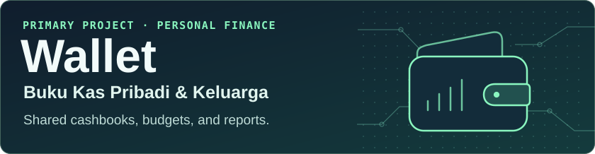
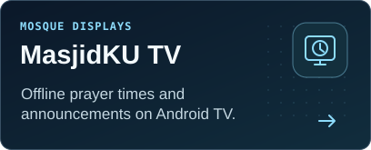
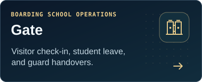

# Irsyads Labs

We build practical software for everyday work at home, in mosques, and in schools. Irsyads Labs is part of [Irsyads](https://irsyads.com/) and is led by [Muhammad Irsyad Sirojul Khoeir](https://github.com/irsyadmsk).

## Current projects

[**Open Wallet**](https://wallet.irsyads.com/) · [Android APK](https://github.com/irsyadmsk/wallet/releases/tag/apk-latest) · [GitHub repository](https://github.com/irsyadmsk/wallet)

<table width="100%">
<tr>
<td width="50%" valign="top"> <a href="https://mosque.irsyads.com/">Open MasjidKU TV</a> · <a href="https://github.com/irsyadmsk/masjidku-downloads">Downloads and releases</a></td>
<td width="50%" valign="top"> <a href="https://gate.irsyads.com/">Open Gate</a> · <a href="https://github.com/irsyadmsk/gate">GitHub repository</a></td>
</tr>
</table>

## More from Irsyads

- [Curriculum](https://curriculum.irsyads.com/) for madrasah curricula, syllabi, and schedules.
- [Academy](https://academy.irsyads.com/) for courses and assessments.
- [Toolkit](https://app.irsyads.com/) for Sundanese script and teaching tools.
- [Verify](https://verify.irsyads.com/) and [Letters](https://letters.irsyads.com/) for documents and electronic signatures.

## Contact

[Website](https://irsyads.com/) · [hello@irsyads.com](mailto:hello@irsyads.com) · [Contact page](https://irsyads.com/contact)
